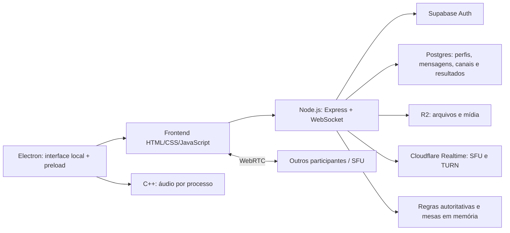

# Análise inicial — M&N / A Lei do Trono

Data: 15/10/2026. Base examinada: commit `17819b0`.
Escopo: código-fonte, testes locais e inspeção visual da comunidade com conta simulada.
Este documento registra o estado encontrado; nenhuma implementação da aplicação foi alterada.

Direcionamento confirmado posteriormente: o foco atual é o desktop Windows. As
capturas e falhas de navegador deste levantamento são evidências complementares;
precisam ser confrontadas com o Electron real antes de priorizar mudanças visuais.
O caminho local está documentado em [Desenvolvimento desktop](DESENVOLVIMENTO_DESKTOP.md).

## Leitura geral

O projeto já reúne uma plataforma de comunicação de comunidade e um catálogo de jogos. A base de comportamento é significativa: autenticação, permissões, mensagens, anexos e regras de jogos têm testes que passaram localmente. A principal oportunidade imediata é tornar a interface e seus testes previsíveis, seguida da separação das responsabilidades hoje concentradas em poucos arquivos.

A experiência combina conceitos de comunicação (M&N) e da Corte/jogo (A Lei do Trono). Isso aparece tanto nos nomes internos quanto nos textos da interface. Convém distinguir esses domínios antes de reorganizar pastas.

## Mapa da arquitetura atual

A mídia usa WebRTC; o WebSocket transporta comandos, estado, mensagens e sinalização. A integração Cloudflare foi examinada no código, sem acessar conta, alterar infraestrutura ou efetuar deploy.

| Área | Implementação atual | Fontes principais |
| --- | --- | --- |
| Servidor | Node.js, Express 4, biblioteca ws; composição, salas, parte das regras e despacho de mensagens | [server.js](C:/Users/Felipe/Documents/Projetos/A-LEI-DO-TRONO-SERVER/server.js:1), [package.json](C:/Users/Felipe/Documents/Projetos/A-LEI-DO-TRONO-SERVER/package.json:1) |
| Interface | JavaScript tradicional, objetos globais Trono*, manipulação direta do DOM; sem build obrigatório | [index.html](C:/Users/Felipe/Documents/Projetos/A-LEI-DO-TRONO-SERVER/frontend/index.html:8), [network.js](C:/Users/Felipe/Documents/Projetos/A-LEI-DO-TRONO-SERVER/frontend/network.js:2) |
| Contas | Login, confirmação, recuperação, renovação, convidados e identidade validada no backend | [auth.js](C:/Users/Felipe/Documents/Projetos/A-LEI-DO-TRONO-SERVER/auth.js:15), [auth-boot.js](C:/Users/Felipe/Documents/Projetos/A-LEI-DO-TRONO-SERVER/frontend/auth-boot.js:1) |
| Comunidade | Cargos, canais de texto/voz/mistos, presença e atividade | [community-management.js](C:/Users/Felipe/Documents/Projetos/A-LEI-DO-TRONO-SERVER/community-management.js:1), [community.js](C:/Users/Felipe/Documents/Projetos/A-LEI-DO-TRONO-SERVER/community.js:1) |
| Mensagens | Histórico de canal, moderação, amigos, mensagens diretas e anexos privados | [chat-history.js](C:/Users/Felipe/Documents/Projetos/A-LEI-DO-TRONO-SERVER/chat-history.js:3), [social-service.js](C:/Users/Felipe/Documents/Projetos/A-LEI-DO-TRONO-SERVER/social-service.js:4) |
| Voz e vídeo | Microfone, câmera, tela, volumes, processamento de ruído, P2P/SFU, recuperação e diagnóstico | [social.js](C:/Users/Felipe/Documents/Projetos/A-LEI-DO-TRONO-SERVER/frontend/social.js:2), [realtime-sfu.js](C:/Users/Felipe/Documents/Projetos/A-LEI-DO-TRONO-SERVER/realtime-sfu.js:38) |
| Desktop | Electron 44.7.0 declarado; interface empacotada localmente; IPC, permissões, atualização e captura | [package.json](C:/Users/Felipe/Documents/Projetos/A-LEI-DO-TRONO-SERVER/desktop/app/package.json:1), [main.cjs](C:/Users/Felipe/Documents/Projetos/A-LEI-DO-TRONO-SERVER/desktop/app/main.cjs:25) |
| Recursos nativos | Helper C++ de captura de áudio da árvore de processos; helper separado C# de clipes | [main.cpp](C:/Users/Felipe/Documents/Projetos/A-LEI-DO-TRONO-SERVER/desktop/native-audio/main.cpp:98), [TronoClips.csproj](C:/Users/Felipe/Documents/Projetos/A-LEI-DO-TRONO-SERVER/desktop/TronoClips/TronoClips.csproj:1) |
| Jogos | Trono, Azul, Splendor, Love Letter e Cinzas; regras compartilhadas e serviços separados parcialmente | [server.js](C:/Users/Felipe/Documents/Projetos/A-LEI-DO-TRONO-SERVER/server.js:40), [azul-service.js](C:/Users/Felipe/Documents/Projetos/A-LEI-DO-TRONO-SERVER/azul-service.js:1), [roguelite-host.js](C:/Users/Felipe/Documents/Projetos/A-LEI-DO-TRONO-SERVER/frontend/roguelite-host.js:1) |

Versões declaradas: backend/frontend de rede 0.13.0-alpha; aplicativo Windows 0.2.2. Não representam a versão efetivamente instalada em produção.

## Fluxos e invariantes que a refatoração precisa preservar

**Identidade:** a interface obtém a sessão por HTTP; o backend valida a identidade no serviço de Auth e usa o perfil persistido. O socket autentica antes de liberar as operações protegidas. Convidados têm escopo reduzido ao jogo. O acesso do criador é vinculado a um e-mail confirmado específico no código e no SQL; tornar isso configurável exige alterar as duas fronteiras de autorização em conjunto, não apenas o frontend. Fontes: [auth.js](C:/Users/Felipe/Documents/Projetos/A-LEI-DO-TRONO-SERVER/auth.js:68), [roles.js](C:/Users/Felipe/Documents/Projetos/A-LEI-DO-TRONO-SERVER/roles.js:3), [server.js](C:/Users/Felipe/Documents/Projetos/A-LEI-DO-TRONO-SERVER/server.js:933).

**Texto de canal:** o servidor verifica associação, serializa operações por sala e aguarda a persistência antes de divulgar a mensagem. Não se deve transformar essa confirmação em uma confirmação antecipada ao extrair módulos. Fonte: [server.js](C:/Users/Felipe/Documents/Projetos/A-LEI-DO-TRONO-SERVER/server.js:312).

**Mensagem direta:** o serviço passa a identidade autenticada às RPCs; amizade, acesso e persistência são tratados pelo banco, e as notificações WebSocket são direcionadas às contas envolvidas. Anexos privados têm autorização própria. Fontes: [social-service.js](C:/Users/Felipe/Documents/Projetos/A-LEI-DO-TRONO-SERVER/social-service.js:9), [files.js](C:/Users/Felipe/Documents/Projetos/A-LEI-DO-TRONO-SERVER/files.js:131).

**Navegação e chamada:** canal de texto, sala de voz e mesa de jogo são associações distintas. Ler outro canal, abrir um jogo ou alternar layout não deve recriar o microfone, perder o socket nem encerrar a chamada. Fontes: [server.js](C:/Users/Felipe/Documents/Projetos/A-LEI-DO-TRONO-SERVER/server.js:199), [server.js](C:/Users/Felipe/Documents/Projetos/A-LEI-DO-TRONO-SERVER/server.js:267), [app-layout.js](C:/Users/Felipe/Documents/Projetos/A-LEI-DO-TRONO-SERVER/frontend/app-layout.js:50).

**Desktop:** o aplicativo serve HTML e scripts do pacote instalado sob a origem esperada. O renderer não recebe Node.js; usa uma ponte de operações explícitas, com isolamento de contexto, sandbox e verificação do remetente IPC. Estas são proteções observadas no código, não uma auditoria completa de segurança. Fontes: [main.cjs](C:/Users/Felipe/Documents/Projetos/A-LEI-DO-TRONO-SERVER/desktop/app/main.cjs:22), [main.cjs](C:/Users/Felipe/Documents/Projetos/A-LEI-DO-TRONO-SERVER/desktop/app/main.cjs:73), [preload.cjs](C:/Users/Felipe/Documents/Projetos/A-LEI-DO-TRONO-SERVER/desktop/app/preload.cjs:4).

**Persistência:** perfis, canais, histórico e resultados de Azul/Splendor têm caminhos persistentes. Participação ao vivo e estado das mesas ficam em estruturas do processo. Portanto, escalar para múltiplas instâncias ou recuperar partidas após reinício exigirá trabalho explícito de coordenação/persistência; adicionar réplicas do servidor não resolve isso sozinho. Fontes: [server.js](C:/Users/Felipe/Documents/Projetos/A-LEI-DO-TRONO-SERVER/server.js:59), [azul-service.js](C:/Users/Felipe/Documents/Projetos/A-LEI-DO-TRONO-SERVER/azul-service.js:1), [splendor-service.js](C:/Users/Felipe/Documents/Projetos/A-LEI-DO-TRONO-SERVER/splendor-service.js:1).

## Achados prioritários

### 1. Restaurar uma base confiável de testes de interface

**Confirmado em execução:** `npm run test:frontend`, com Edge indicado por `AUTH_TEST_CHROMIUM`, falha ao esperar visibilidade de `#chatOnlyScreen`. A mesma tela apareceu na inspeção visual: o contêiner tem `display:block`, `visibility:visible`, mas altura zero. Os painéis e controles continuam renderizados fora do fluxo normal.

Isso impede o restante dessa suíte de verificar os cenários previstos. Não é evidência de que toda a comunidade esteja invisível. O CSS novo torna a seção estática, zera seu tamanho mínimo e posiciona painéis de forma fixa. Fontes: [call-workspace.css](C:/Users/Felipe/Documents/Projetos/A-LEI-DO-TRONO-SERVER/frontend/call-workspace.css:3), [frontend-browser.js](C:/Users/Felipe/Documents/Projetos/A-LEI-DO-TRONO-SERVER/tests/frontend-browser.js:20). Log: [frontend-analysis-test.log](C:/Users/Felipe/Documents/Projetos/A-LEI-DO-TRONO-SERVER/artifacts/frontend-analysis-test.log).

Próximo passo: definir qual elemento representa a área visível da comunidade e fazer o teste verificar a experiência observável, incluindo controles e conteúdo. Não simplesmente remover a asserção. Depois executar o restante da suíte para descobrir falhas posteriores.

Há também testes de layout com `/usr/bin/chromium` fixo, sem usar a variável já suportada pela suíte principal de frontend. Exemplos: [app-layout-browser.js](C:/Users/Felipe/Documents/Projetos/A-LEI-DO-TRONO-SERVER/tests/app-layout-browser.js:18), [settings-portrait-browser.js](C:/Users/Felipe/Documents/Projetos/A-LEI-DO-TRONO-SERVER/tests/settings-portrait-browser.js:14). Centralizar a seleção do navegador permitirá repetir a validação no Windows.

### 2. Dar a um único módulo a responsabilidade pelo layout da chamada

**Observado no código:** `app-layout.js`, `call-workspace.js` e `desktop-shell.js` movem controles existentes entre contêineres e sincronizam estado com eventos e MutationObserver. Preservar os nós evita perder listeners e mídia, mas vários proprietários do mesmo DOM tornam a ordem de execução parte implícita do contrato.

Fontes: [app-layout.js](C:/Users/Felipe/Documents/Projetos/A-LEI-DO-TRONO-SERVER/frontend/app-layout.js:4), [call-workspace.js](C:/Users/Felipe/Documents/Projetos/A-LEI-DO-TRONO-SERVER/frontend/call-workspace.js:13), [desktop-shell.js](C:/Users/Felipe/Documents/Projetos/A-LEI-DO-TRONO-SERVER/frontend/desktop-shell.js:48).

Recomendação: criar um controlador único de apresentação da chamada, separando estado de mídia, comandos e locais de renderização. Layout Original/Discord e desktop/web devem ser entradas desse controlador. Esta é uma proposta estrutural; não foi comprovada perda de chamada causada por esses módulos nesta análise.

### 3. Reequilibrar a interface de comunicação

**Observado visualmente, com um usuário e chamada vazia:**

- Na viewport de 1488 × 1244, o chat ocupa 280 px e o campo de texto mede apenas 125 px; a região de mídia vazia domina a tela.
- Em 390 × 844, o chat abre como painel sobre a chamada e o campo de texto mede 225 px. A barra inferior permanece acessível, mas os rótulos de vários controles ficam cortados/pequenos.
- O estado vazio da chamada, em celular, fica restrito à primeira coluna da grade de participantes.
- Existem caminhos de navegação repetidos para início, jogos e comunidade; os termos Call, Chat de Voz e Comunidade convivem na mesma experiência.

Proposta: dar destaque ao texto quando não houver mídia ativa; oferecer entrar na chamada perto do estado vazio; usar um estado vazio que ocupe toda a grade; simplificar navegação e padronizar rótulos/ícones. Preservar um acesso consistente a microfone, escuta e sair da chamada.

Capturas locais: [desktop](C:/Users/Felipe/Documents/Projetos/A-LEI-DO-TRONO-SERVER/artifacts/analysis-community.png), [celular com chat aberto](C:/Users/Felipe/Documents/Projetos/A-LEI-DO-TRONO-SERVER/artifacts/analysis-community-mobile.png). Não houve captura de microfone, câmera ou tela reais.

### 4. Reduzir concentração e dependências implícitas

**Medido:** o HTML inicial referencia 51 arquivos JavaScript e 31 folhas de estilo, somando 745.802 bytes de JS e 595.933 bytes de CSS em disco, sem compressão e sem contar imagens, áudio, WASM ou recursos carregados depois. Isso mede superfície inicial, não tempo de carregamento ou tráfego real.

`social.js` tem aproximadamente 209 KB e reúne captura, processamento, reprodução, transporte, chat, telemetria e apresentação. `server.js` tem aproximadamente 77 KB e combina composição, salas, jogo e despacho. `game.js` tem aproximadamente 109 KB. O código frequentemente concentra muitas instruções por linha.

Recomendação: formatar em alterações separadas; extrair primeiro funções puras e fronteiras de serviços; manter fachadas compatíveis para os consumidores atuais. Introduzir contratos de mensagens e tipos gradualmente. Uma troca completa de framework não é pré-requisito para essas melhorias.

### 5. Consolidar CSS e regras compartilhadas

**Observado:** a página carrega camadas como style, modern, refinements, desktop-shell, app-layout e call-workspace em ordem. A camada nova usa seletores amplos e muitos `!important`, sobrepondo layouts anteriores.

Recomendação: organizar tokens de cor/espaçamento/tipografia, estilos de componentes e variações de layout com precedência explícita. Remover regras antigas apenas com cobertura visual das combinações afetadas.

O backend importa regras diretamente de `frontend/`. O compartilhamento das mesmas regras é útil, mas o diretório transmite uma responsabilidade incorreta. Extrair regras puras para um pacote/diretório compartilhado, atualizando publicação estática e empacotamento juntos. Fontes: [index.html](C:/Users/Felipe/Documents/Projetos/A-LEI-DO-TRONO-SERVER/frontend/index.html:11), [azul-service.js](C:/Users/Felipe/Documents/Projetos/A-LEI-DO-TRONO-SERVER/azul-service.js:3), [splendor-service.js](C:/Users/Felipe/Documents/Projetos/A-LEI-DO-TRONO-SERVER/splendor-service.js:3).

### 6. Melhorar onboarding e integração contínua

**Observado:** o README acumula instruções de diferentes versões e cita `.env.example`, que não foi encontrado nesta árvore. Os arquivos SQL combinam upgrades manuais com uma migração datada recente. É necessário documentar uma instalação nova reproduzível e o estado esperado do banco.

Os três workflows encontrados são voltados a push/publicação ou execução manual; não há gatilho `pull_request` nesses arquivos. `test:profiles` existe separadamente, mas não integra `npm test` e não foi encontrado nos workflows pesquisados. Isso deixa a proteção de perfis dependente de execução manual ou de outro mecanismo não observado.

Recomendação: uma rotina de CI para contribuições que rode backend, SQL, perfis e fluxos essenciais da interface, separada do empacotamento/publicação. Fontes: [package.json](C:/Users/Felipe/Documents/Projetos/A-LEI-DO-TRONO-SERVER/package.json:9), [windows-app.yml](C:/Users/Felipe/Documents/Projetos/A-LEI-DO-TRONO-SERVER/.github/workflows/windows-app.yml:1), [README.md](C:/Users/Felipe/Documents/Projetos/A-LEI-DO-TRONO-SERVER/README.md:60).

## Validação executada

| Verificação | Resultado e limite |
| --- | --- |
| Instalação pela lockfile | 73 pacotes instalados com scripts de instalação desabilitados; sem instalar dependências Electron |
| `npm test` | Passou: 4 executáveis iniciais de integração e 79 testes reportados pelos grupos node:test; serviços externos simulados |
| Perfis, notificações, estabilidade, recepção e políticas/preferências desktop | 15 testes distintos passaram ao final; quatro falhas iniciais de arquivos temporários eram restrições do sandbox e passaram na repetição externa |
| `npm run test:frontend` com Edge | Falhou na primeira verificação de visibilidade; os cenários posteriores não foram executados |
| Inspeção visual local | Comunidade carregada em desktop e 390 × 844; confirmação do contêiner sem altura e das observações de layout |

A suíte principal também confirmou persistência de mensagens após reinício, rejeição de mensagens não gravadas, isolamento de canais, restrições de convidados e privacidade das mãos nos jogos.

Não foram validados: infraestrutura de produção; fluxo real de e-mail; SFU/TURN entre redes reais; R2 real; áudio em dispositivos reais sob carga; instalador/atualizador Electron em execução; todas as telas de jogos; acessibilidade completa por teclado/leitor de tela; desempenho sob muitos usuários. Não há afirmação de auditoria completa de segurança ou equivalência entre código e binário distribuído.

## Sequência proposta de contribuição

1. **Base de validação:** navegador configurável, teste inicial compatível com a tela atual, perfis no conjunto de CI, instruções locais e instalação de banco verificáveis.
2. **Primeira melhoria visual:** comunidade sem chamada, chat com espaço útil, barra de controles legível e estado vazio responsivo. Critério: navegação e identidade de mídia preservadas.
3. **Primeira extração estrutural:** controlador de layout da chamada e separação entre estado de chamada e apresentação. Critério: alternar layout/canal/jogo sem recriar tracks ou socket.
4. **Serviços do servidor:** separar montagem HTTP/WS, associação às salas, chat e jogo do Trono; introduzir adaptadores de persistência sem misturar autorização de usuário e chave de serviço.
5. **Organização compartilhada:** regras puras, contratos de mensagens e testes por domínio; atualizar publicação web e empacotamento desktop em conjunto.
6. **Consolidação visual:** tokens, componentes comuns, remoção das camadas CSS redundantes e carregamento por área, com medição antes/depois.

Uma estrutura possível, como destino gradual, é `apps/web`, `apps/server`, `apps/desktop`, `packages/game-rules`, `packages/protocol`, `database` e `docs`. A extração de responsabilidades deve vir antes da mudança em massa de caminhos.

## REA / Ghidra e cobertura da investigação

A skill reverse-engineer-anything foi lida e o catálogo da sessão anuncia 170 ferramentas REA. Isso confirma a disponibilidade das interfaces, não o funcionamento do motor Ghidra. A skill orienta usar ferramentas normais para análise de repositório com fonte disponível; não foi aberto binário ou executado diagnóstico de motor.

Ghidra passa a ser útil se houver uma pergunta sobre um EXE/DLL distribuído que não possa ser respondida pelo fonte, ou sobre divergência entre pacote e repositório. A captura C++ também tem fonte presente.

| Pergunta inicial | Cobertura |
| --- | --- |
| O que já foi criado? | Mapeado por subsistema, com confirmação parcial por execução |
| Como as partes se conectam? | Fluxos principais rastreados no código e exercitados pelas suítes indicadas |
| Onde melhorar a interface? | Comunidade examinada em duas larguras; demais telas ainda exigem rodada visual |
| Onde iniciar a refatoração? | Prioridades e invariantes registrados; proposta ainda não implementada |
| REA/Ghidra estão operacionais? | Ferramentas REA expostas; Ghidra não exercitado, por falta de necessidade neste escopo |
