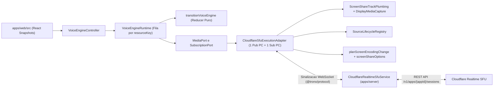
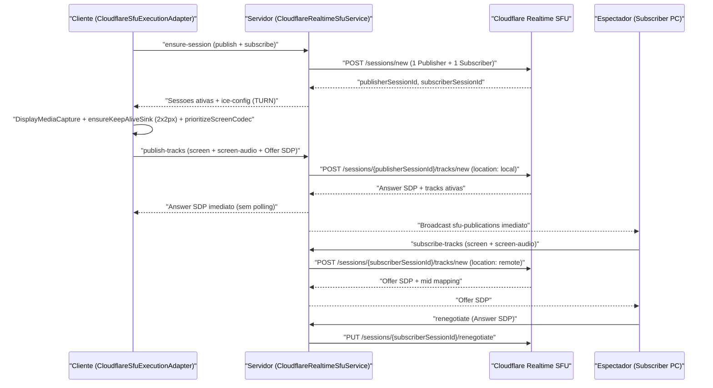

# Arquitetura do Motor de Voz e Transmissão de Tela

Este documento descreve a arquitetura baseada no **`@fluxer/voice_engine_v2`** integrada ao **Cloudflare Realtime SFU** por meio de **Sessões Assimétricas Persistentes**.

## Visão Geral dos Módulos Profundos (_Deep Modules_)

Em vez de espalhar estado WebRTC mutável por dezenas de hooks e serviços acoplados, toda a orquestração de voz, câmera e compartilhamento de tela é encapsulada em três camadas com fronteiras rígidas:

1. **`@trono/protocol` (`packages/protocol`)**: contratos discriminados e validadores puros das ações SFU (`ensure-session`, `publish-tracks`, `unpublish-tracks`, `subscribe-tracks`, `renegotiate`, `update-subscription`, `close-session`, `ice-config`, `list-publications`).
2. **`@trono/voice-engine` (`packages/voice-engine`)**:
   - **Núcleo puro (`core/` + `protocol/`)**: `transitionVoiceEngine(snapshot, event)` gera o próximo snapshot imutável e a lista de comandos com `operationId` monotônico, validados por `isCommandCompletionStale`.
   - **Runtime (`runtime/`)**: `VoiceEngineRuntime` e `VoiceEngineController` serializam comandos assíncronos por `resourceKey` (`connection`, `microphone`, `camera`, `screen`, `screenAudio`, `subscription:${participantId}:${kind}`), rastreiam `AbortController` por operação e descartam conclusões obsoletas.
   - **Políticas de Tela (`policies/`)**:
     - `planScreenEncodingChange` decide entre `'noop'`, `'updateEncoding'` (dimensões/FPS/bitrate/`contentHint`), `'republish'` (`codec`, `hardwareEncoding`, `zeroCopyRequired`, `simulcast`) ou `'reject'`.
     - `screenShareOptions.ts` fornece presets (`low_480p`, `720p`, `1080p`, `1440p`, `source`), frame rates `[15, 30, 60]`, `floorToEven`, `resolveEffectiveScreenShareDimensions`, `resolveScreenShareDegradationPreference` e `buildScreenShareSenderParameters`.
   - **Isolamento de Captura (`source-isolation/`)**: `SourceLifecycleRegistry` rastreia `MediaStreamTrack`s por `captureId` e `sourceKey`, garantindo `track.stop()` em substituições e paradas sem jamais encerrar tracks ainda referenciadas por uma captura mais nova.
   - **Adaptadores de Tela e SFU (`adapters/`)**:
     - `DisplayMediaCapture`: configura `getDisplayMedia` com `windowAudio: 'window'`, `systemAudio: 'include'`, `selfBrowserSurface: 'exclude'`, `restrictOwnAudio: true`, DSP de voz desligado (`echoCancellation: false`, `noiseSuppression: false`, `autoGainControl: false`) e limpeza integral em falha parcial.
     - `ScreenShareTrackPlumbing`: mantém `<video data-flx="voice.screen-share-keepalive">` (`2x2px`, `position: fixed`, `opacity: 0.001`, `visibility: hidden`, `pointerEvents: none`, `muted`, `playsInline`) enquanto a tela é transmitida para evitar suspensão de frames no Chromium/Electron; aplica `contentHint` (`motion`, `detail`, `text`), parâmetros do `RTCRtpSender` e priorização de codec via `prioritizeScreenCodec` preservando pares `video/rtx` adjacentes (H.264 Constrained Baseline `42e0`, VP9 Profile 0, VP8 e AV1).
     - `CloudflareSfuExecutionAdapter`: implementa `CloudflareSfuMediaPort` e `SubscriptionPort` mantendo no máximo 2 `RTCPeerConnection`s por chamada (1 Publisher + 1 Subscriber) com filas de renegociação serializadas.
3. **`@trono/server` (`apps/server/src/modules/sfu/`)**:
   - `CloudflareRealtimeSfuService` mantém no máximo 1 `publisherSessionId` e 1 `subscriberSessionId` por participante na chamada, serializa mutações por sessão em `sessionQueues`, publica `screen` + `screen-audio` atomicamente em um único `POST /sessions/{id}/tracks/new` (`location: 'local'`) e anuncia `sfu-publications` imediatamente após Answer SDP válido — eliminando o antigo atraso artificial de ICE gather e o polling de `publication-ready`.
   - `CloudflareCallsClient`, `TurnIceService` e `UsagePolicy` isolam HTTP, credenciais TURN temporárias e limites mensais/moderação.

## Diagrama de Componentes e Fronteiras

## Fluxo Assimétrico de Publicação de Tela e Assinatura

## Tabela de Donos por Caminho

| Domínio               | Caminho Dono                                               | Responsabilidade                                                                         |
| --------------------- | ---------------------------------------------------------- | ---------------------------------------------------------------------------------------- |
| Contratos SFU         | `packages/protocol/src/sfu.ts`                             | Tipos discriminados e validadores puros de payloads WebSocket                            |
| Núcleo e Runtime      | `packages/voice-engine/src/{protocol,core,ports,runtime}/` | Estado imutável, reducers, `operationId` e filas por `resourceKey`                       |
| Políticas de Tela     | `packages/voice-engine/src/policies/`                      | Planejamento de encoding (`noop`/`updateEncoding`/`republish`) e presets                 |
| Isolamento de Tracks  | `packages/voice-engine/src/source-isolation/`              | Dono único das tracks capturadas (`SourceLifecycleRegistry`)                             |
| Captura e Plumbing    | `packages/voice-engine/src/adapters/screen-share/`         | `getDisplayMedia`, _keep-alive sink_ `2x2px`, `contentHint`, `video/rtx`                 |
| Adaptador Cliente SFU | `packages/voice-engine/src/adapters/cloudflare-sfu/`       | `CloudflareSfuExecutionAdapter` (1 Publisher PC + 1 Subscriber PC)                       |
| Serviço Backend SFU   | `apps/server/src/modules/sfu/`                             | `CloudflareRealtimeSfuService`, `CloudflareCallsClient`, `TurnIceService`, `UsagePolicy` |
| Frontend Estático     | `apps/web/`                                                | Interface Next.js (`apps/web/src/`, `output: 'export'` -> `apps/web/out/`)               |
| Host Desktop          | `apps/desktop/`                                            | Janela Electron, helpers nativos e captura desktop                                       |
