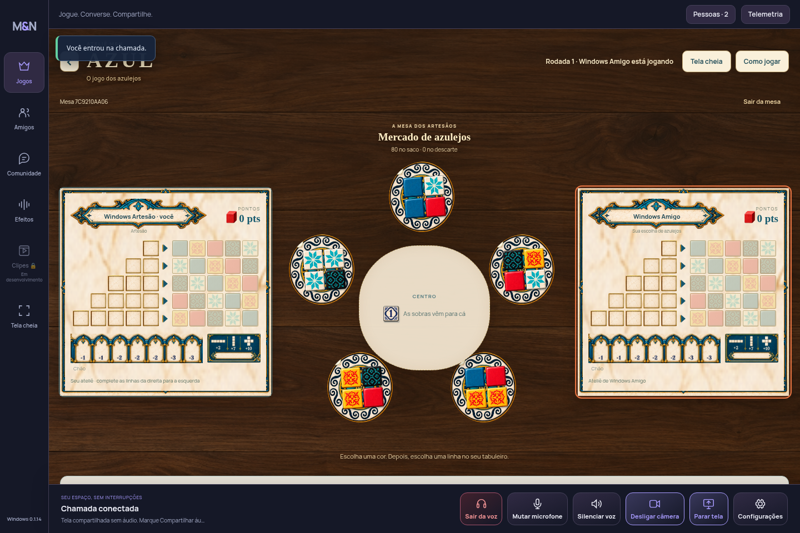
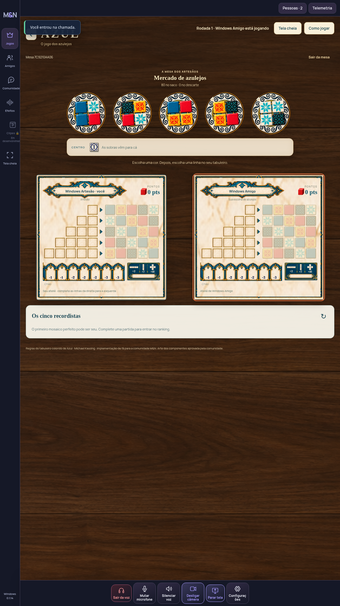
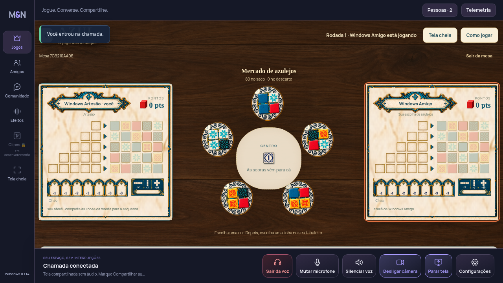
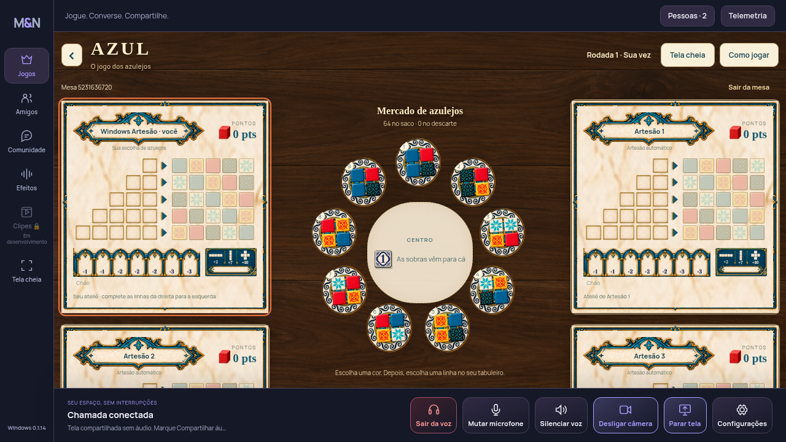
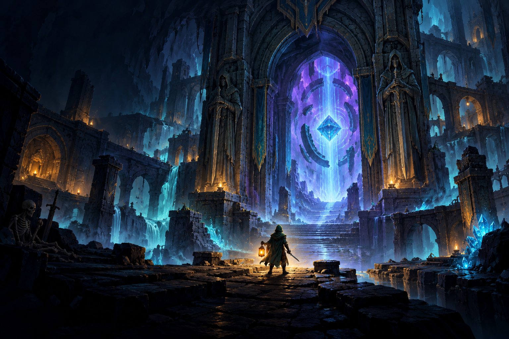
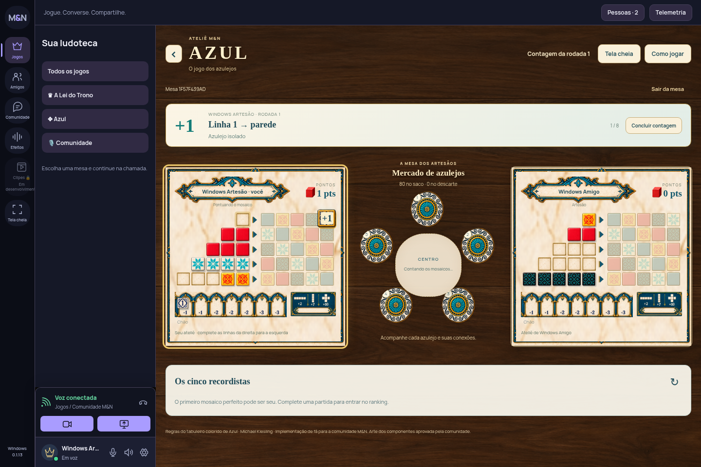
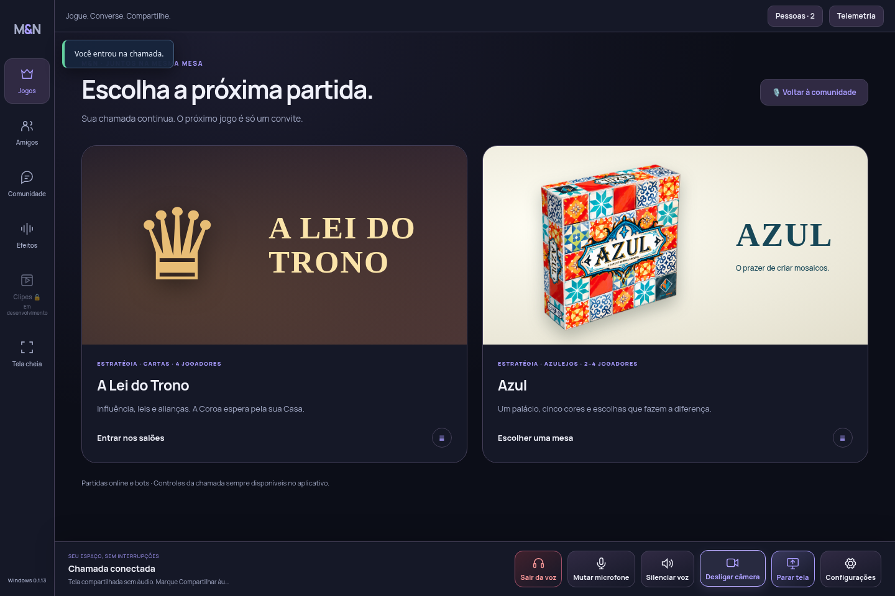
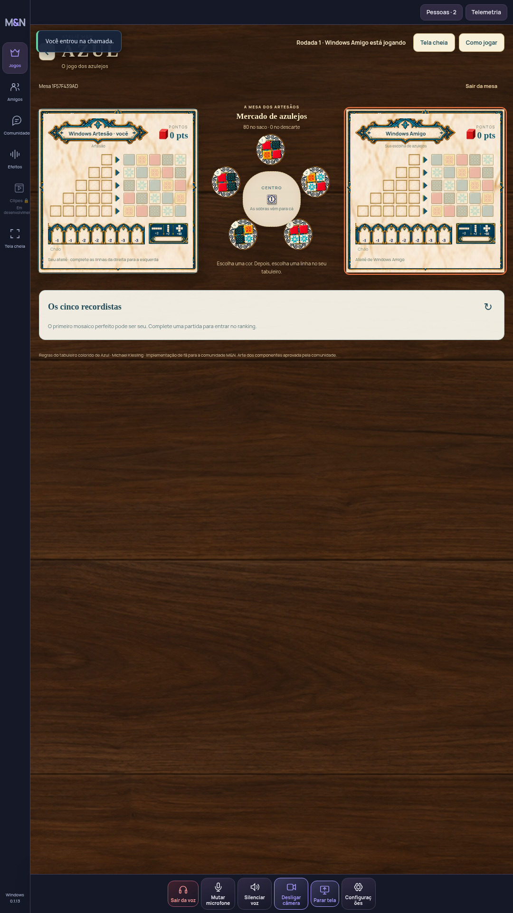

# Azul · Windows e site 0.1.14

O mercado usa uma parte maior da mesa e os murais ficam mais compactos. A disposição muda com a largura disponível e a orientação do monitor, preservando a chamada.

## Capa preparada para o roguelite

Proposta de fantasia, com espaço para sobrepor o título no catálogo. O jogo ainda depende do fornecimento da última versão feita em paralelo. Esta arte está somente na prévia; não aparece como um jogo disponível e não aumenta o pacote para Surge.

## Artes da versão anterior · 0.1.13

Capturas da interface real, geradas no teste do navegador com uma partida e a chamada ativas. Os nomes são contas locais de teste. As artes aprovadas foram aplicadas às células clicáveis, aos expositores, ao chão e ao painel de bônus. O fundo simula uma mesa de madeira.

## Partida e contagem de pontos

## Catálogo com a capa

## Monitor vertical

Estas capturas são somente para revisão no GitHub. Ficam fora do frontend e não aumentam o pacote publicado no Surge ou o instalador.
