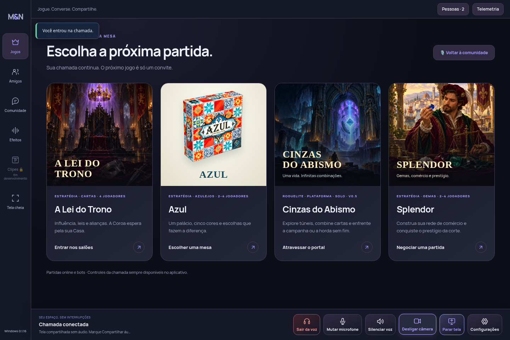
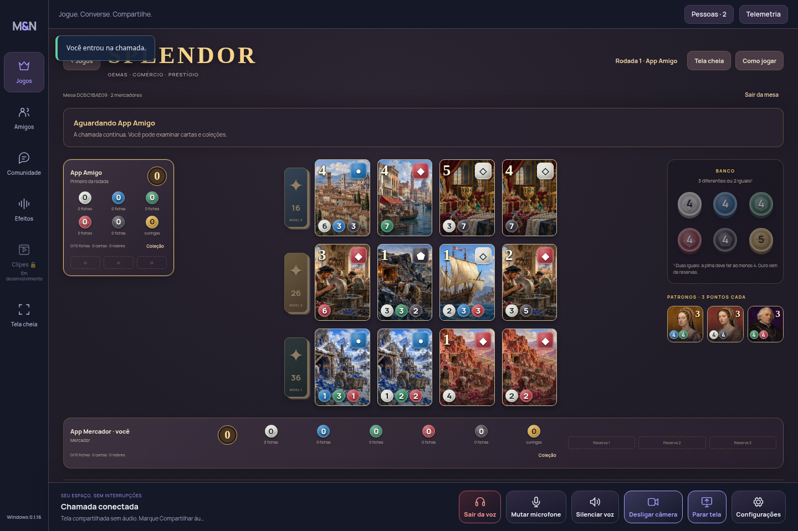
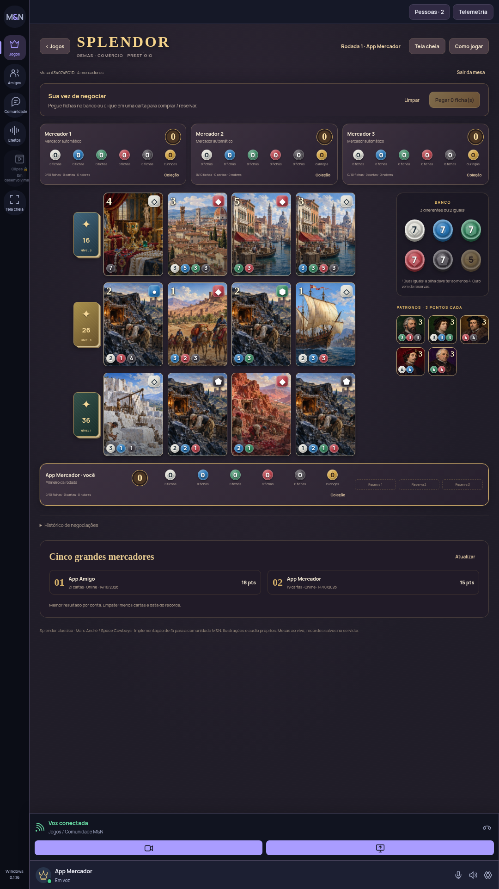
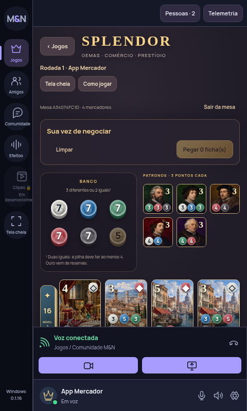
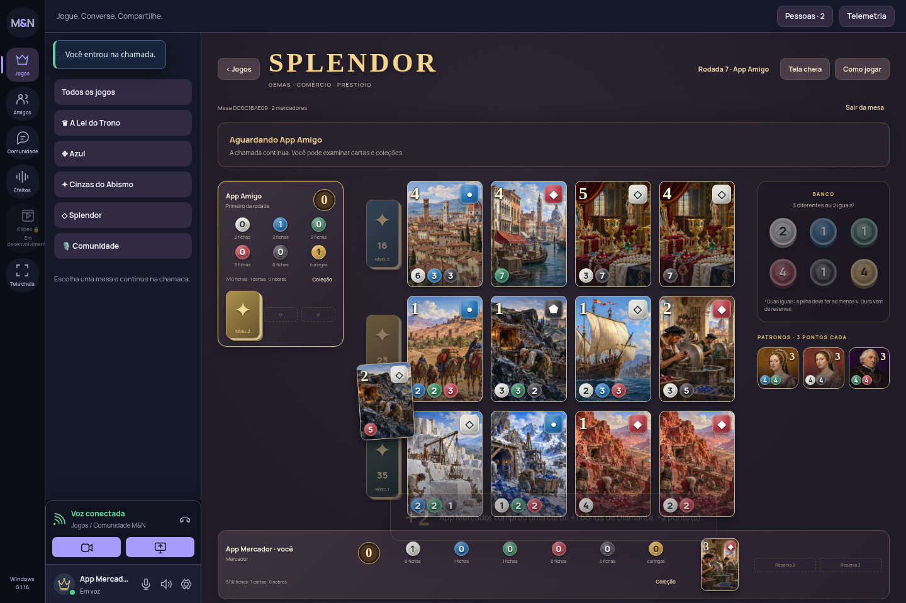
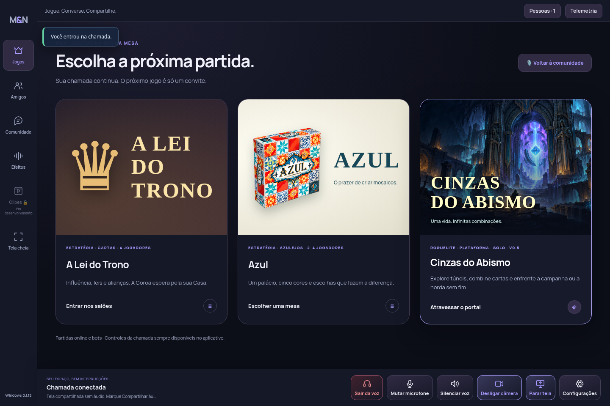
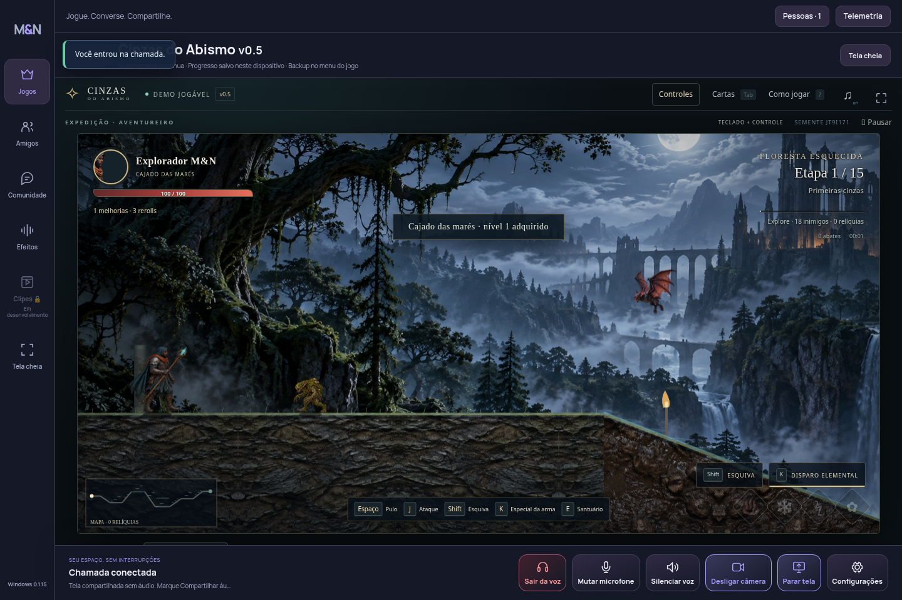
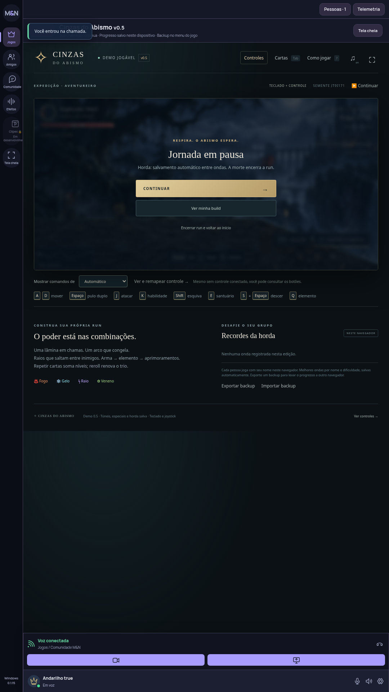

# Windows 0.1.17 · Love Letter e Splendor

Capturas da interface real, com chamada, câmera e compartilhamento ativos. Dados e decisões vêm do backend de teste autenticado. As ilustrações são originais; o conceito de Love Letter foi convertido em HTML/CSS funcional.

- [Love Letter · quatro participantes](LOVE-LETTER-MESA-0.1.17.png)
- [Love Letter · monitor vertical](LOVE-LETTER-VERTICAL-0.1.17.png)
- [Love Letter · 720p](LOVE-LETTER-COMPACTO-0.1.17.png)
- [Love Letter · seis participantes](LOVE-LETTER-SEIS-0.1.17.png)
- [Splendor · nova arte e mesa](SPLENDOR-MESA-0.1.17.png)
- [Splendor · vertical](SPLENDOR-VERTICAL-0.1.17.png)

Os PNGs desta pasta são referências e originais de arte; não entram no pacote do site/aplicativo.

# Jogos · Windows e site 0.1.16

Prévia real do catálogo e Splendor com a chamada ativa. Capturas dos testes do navegador; o executável compilado também é verificado no Windows.

Artes de capa sem texto: [A Lei do Trono](ART-TRONO-CAPA.png) e [Splendor](ART-SPLENDOR-CAPA.png). Estes arquivos de revisão não fazem parte do frontend publicado.

---

# Jogos · Windows e site 0.1.15

Cinzas do Abismo v0.5 integrado ao M&N, com a chamada ativa e a capa animada no catálogo. Capturas da interface real em testes locais; os nomes exibidos são contas de teste.

O jogo mantém campanha, horda, controles e backups da versão enviada. Ao sair para o chat, a partida pausa e a renderização é interrompida. No Windows, artes e músicas são guardadas na primeira abertura para permitir uso offline depois do preparo. Música começa mutada e gráficos em Leve, ajustáveis no menu Controles do jogo.

Estas imagens de revisão não entram no frontend nem no instalador.

## Azul · versão 0.1.14

O mercado usa uma parte maior da mesa e os murais ficam mais compactos. A disposição muda com a largura disponível e a orientação do monitor, preservando a chamada.

## Artes da versão anterior · 0.1.13

Capturas da interface real, geradas no teste do navegador com uma partida e a chamada ativas. Os nomes são contas locais de teste. As artes aprovadas foram aplicadas às células clicáveis, aos expositores, ao chão e ao painel de bônus. O fundo simula uma mesa de madeira.

## Partida e contagem de pontos

## Catálogo com a capa

## Monitor vertical

Estas capturas são somente para revisão no GitHub. Ficam fora do frontend e não aumentam o pacote publicado no Surge ou o instalador.
