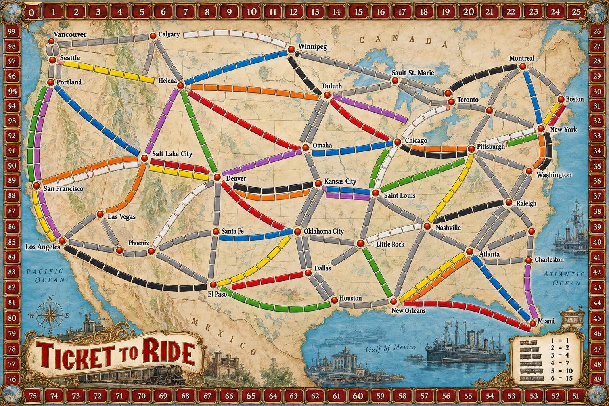
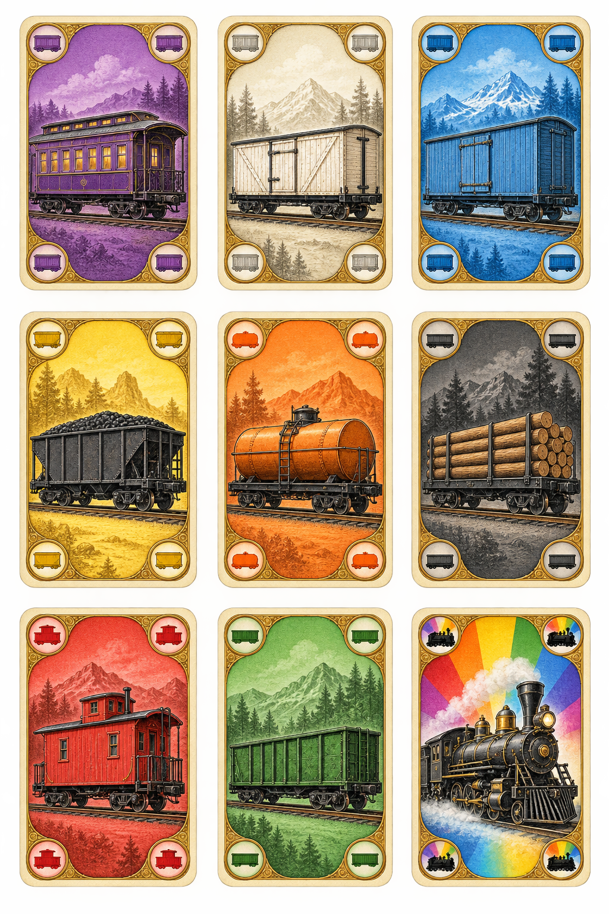
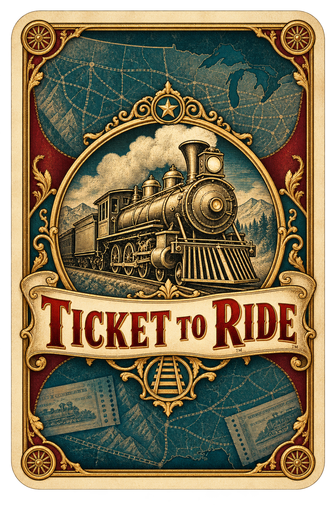

# Ticket to Ride · artes para visualização

Recriações visuais geradas para a versão 0.3.0, inspiradas no jogo clássico dos EUA.
Os PNGs estão disponíveis abaixo em tamanho original. Clique na imagem para abrir
sua página no GitHub e use o botão de download para salvar o arquivo.

## Tabuleiro dos EUA

[Baixar PNG](TABULEIRO-EUA.png?raw=true)

## Quatro variações de vagão

Vermelho, azul, verde e amarelo.

[Baixar PNG](VAGOES-QUATRO-CORES.png?raw=true)

## Frentes das cartas de vagão

Oito cartas coloridas e uma locomotiva coringa, em uma prancha 3×3.

[Baixar PNG](CARTAS-FRENTES.png?raw=true)

## Verso comum das cartas

[Baixar PNG](CARTAS-VERSO.png?raw=true)

