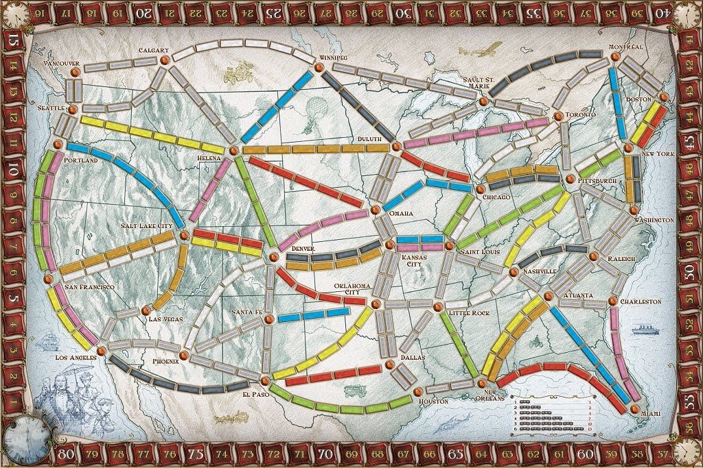
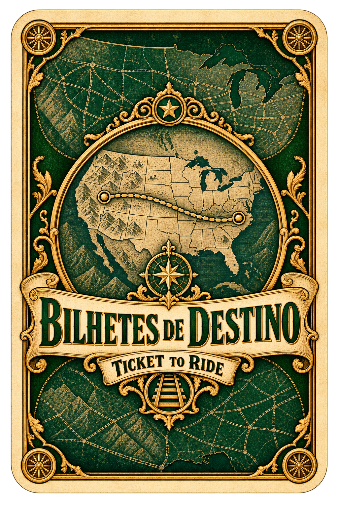

# Ticket to Ride · tabuleiro e cartas

[**Baixar todas as imagens em ZIP — 13,7 MB**](Ticket-to-Ride-Artes-Completas.zip?raw=true)

Imagens para visualizar e baixar. Clique em uma imagem para abri-la no GitHub.

## Tabuleiro clássico dos EUA

Imagem limpa do tabuleiro original correspondente à referência enviada, sem
cartas ou peças sobre o mapa. As rotas, as casas e a trilha de pontuação são
preservadas no arquivo de origem. Resolução disponível: **1024 × 683 pixels**.

[Baixar tabuleiro original](TABULEIRO-EUA-ORIGINAL.jpg?raw=true) · [Fonte e identificação do arquivo](FONTES.md)

## Verso das cartas de objetivos

Baralho de bilhetes de destino, com mapa, dois marcadores e identidade verde.
Arte gerada no mesmo estilo do conjunto de cartas, em **1024 × 1536 pixels**.

[Baixar verso dos objetivos](CARTAS-OBJETIVOS-VERSO.png?raw=true)

## Quatro variações de vagão

Vermelho, azul, verde e amarelo.

[Baixar PNG](VAGOES-QUATRO-CORES.png?raw=true)

## Frentes das cartas de vagão

Oito cartas coloridas e uma locomotiva coringa, em uma prancha 3×3.

[Baixar PNG](CARTAS-FRENTES.png?raw=true)

## Verso das cartas de vagão

[Baixar PNG](CARTAS-VERSO.png?raw=true)

